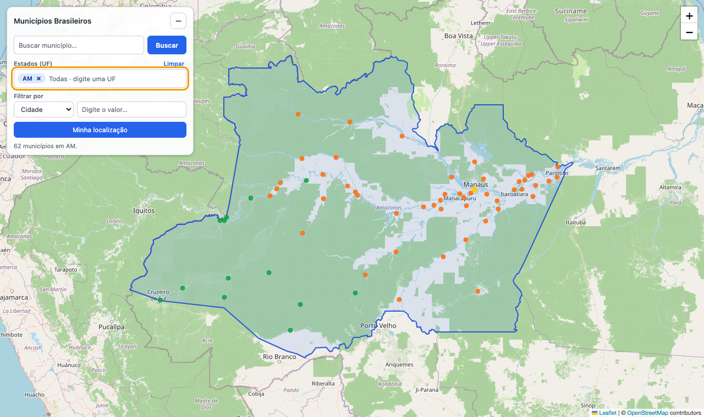

# Municípios Brasileiros

[](https://github.com/95wesley/municipios-brasileiros/actions/workflows/validate.yml)
[](CHANGELOG.md)
[](LICENSE)

Os **5.570 municípios** e as **27 UFs** do Brasil em arquivos `SQL`, `CSV` e `JSON`, com código IBGE, capital, código SIAFI, DDD, fuso horário e **latitude/longitude** de cada município.

**[▶ Abrir o mapa interativo](https://95wesley.github.io/municipios-brasileiros/web/)** · [Dados (CSV)](csv/municipios.csv) · [Changelog](CHANGELOG.md)



## Sumário

- [Início rápido](#início-rápido)
- [Os dados em números](#os-dados-em-números)
- [Campos](#campos)
- [Exemplos](#exemplos)
- [Explorador web: mapa interativo](#explorador-web-mapa-interativo)
- [Servidor MCP](#servidor-mcp)
- [Scripts e validação](#scripts-e-validação)
- [Qualidade dos dados](#qualidade-dos-dados)
- [Contribuição](#contribuição)
- [Créditos e licença](#créditos-e-licença)

## Início rápido

| Eu quero…                                   | Faça isto                                                                                   |
| ------------------------------------------- | ------------------------------------------------------------------------------------------- |
| Explorar os municípios no mapa              | Abra o [mapa interativo](https://95wesley.github.io/municipios-brasileiros/web/)            |
| Usar os dados num banco ou planilha         | Baixe [`sql/`](sql/), [`csv/`](csv/) ou [`json/`](json/)                                    |
| Consultar os dados num assistente de IA     | Configure o [servidor MCP](#servidor-mcp)                                                   |
| Contribuir ou regenerar os arquivos         | Veja [Scripts e validação](#scripts-e-validação)                                            |

## Os dados em números

| Item                       | Valor                                                                       |
| -------------------------- | --------------------------------------------------------------------------- |
| Municípios                 | 5.570                                                                       |
| Unidades da federação (UF) | 27                                                                          |
| Capitais                   | 27 (uma por UF)                                                             |
| Grandes regiões            | 5 (Norte, Nordeste, Sudeste, Sul, Centro-Oeste)                             |
| Fusos horários             | 4 (`America/Sao_Paulo`, `America/Porto_Velho`, `America/Rio_Branco`, `America/Noronha`) |
| Valores vazios             | 0                                                                           |

## Campos

### Municípios (`municipios`)

| Campo          | Tipo    | Descrição                                                                |
| -------------- | ------- | ------------------------------------------------------------------------ |
| `codigo_ibge`  | inteiro | Código IBGE do município (7 dígitos). Chave primária.                    |
| `nome`         | texto   | Nome do município.                                                       |
| `latitude`     | decimal | Latitude em graus decimais.                                              |
| `longitude`    | decimal | Longitude em graus decimais.                                             |
| `capital`      | 0 ou 1  | `1` se for a capital da UF, `0` caso contrário (`BOOLEAN` no SQL).       |
| `codigo_uf`    | inteiro | Código IBGE da UF. Chave estrangeira para `estados`.                     |
| `siafi_id`     | texto   | Código SIAFI com 4 dígitos. **Mantém os zeros à esquerda** (ex.: `"0401"`). |
| `ddd`          | inteiro | Código DDD.                                                              |
| `fuso_horario` | texto   | Fuso horário IANA (ex.: `America/Sao_Paulo`).                            |

### Estados (`estados`)

| Campo       | Tipo    | Descrição                                                              |
| ----------- | ------- | ---------------------------------------------------------------------- |
| `codigo_uf` | inteiro | Código IBGE da UF. Chave primária.                                     |
| `uf`        | texto   | Sigla da UF (ex.: `GO`).                                               |
| `nome`      | texto   | Nome da UF.                                                            |
| `latitude`  | decimal | Coordenada de referência da UF.                                        |
| `longitude` | decimal | Coordenada de referência da UF.                                        |
| `regiao`    | texto   | Grande região (`Norte`, `Nordeste`, `Sudeste`, `Sul`, `Centro-Oeste`). |

Para saber a região de um município, faça a junção com `estados` pelo `codigo_uf`.

## Exemplos

### CSV

```csv
codigo_ibge,nome,latitude,longitude,capital,codigo_uf,siafi_id,ddd,fuso_horario
5200050,Abadia de Goiás,-16.7573,-49.4412,0,52,1050,62,America/Sao_Paulo
2704302,Maceió,-9.66599,-35.735,1,27,2785,82,America/Sao_Paulo
5106752,Pontes e Lacerda,-15.2219,-59.3435,0,51,8999,65,America/Porto_Velho
4314902,Porto Alegre,-30.0318,-51.2065,1,43,8801,51,America/Sao_Paulo
```

### JSON

```json
[
    {
        "codigo_ibge": 2704302,
        "nome": "Maceió",
        "latitude": -9.66599,
        "longitude": -35.735,
        "capital": 1,
        "codigo_uf": 27,
        "siafi_id": "2785",
        "ddd": 82,
        "fuso_horario": "America/Sao_Paulo"
    }
]
```

### SQL

```sql
CREATE TABLE municipios(
    codigo_ibge INT NOT NULL,
    nome VARCHAR(100) NOT NULL,
    latitude FLOAT(8) NOT NULL,
    longitude FLOAT(8) NOT NULL,
    capital BOOLEAN NOT NULL,
    codigo_uf INT NOT NULL,
    siafi_id VARCHAR(4) NOT NULL UNIQUE,
    ddd INT NOT NULL,
    fuso_horario VARCHAR(32) NOT NULL,
    PRIMARY KEY (codigo_ibge),
    FOREIGN KEY (codigo_uf) REFERENCES estados (codigo_uf)
);

INSERT INTO municipios VALUES
(2704302,'Maceió',-9.66599,-35.735,TRUE,27,'2785',82,'America/Sao_Paulo'),
...;
```

A tabela `estados` segue o mesmo padrão e está em [`sql/estados.sql`](sql/estados.sql).

## Explorador web: mapa interativo

A pasta [`web/`](web/) tem um explorador estático, sem etapa de build:

- **Mapa** com os 5.570 municípios, coloridos por fuso horário, com as capitais destacadas, usando tiles do [OpenStreetMap](https://www.openstreetmap.org/copyright);
- **Busca** por nome com sugestões enquanto você digita (use as setas e Enter para escolher), sem diferenciar acentos nem maiúsculas;
- **Contorno dos estados**: ao escolher uma UF, o estado aparece demarcado no mapa, com o contorno oficial do IBGE. Só o código da UF é enviado ao serviço de malhas do IBGE;
- **Filtro por UF** com seleção múltipla: digite a sigla ou o nome do estado e escolha quantos quiser; cada UF escolhida vira um chip;
- **Filtro por campo**: escolha entre cidade, código IBGE, DDD ou fuso horário e digite o valor. Os filtros de UF e de campo se combinam;
- **Minha localização**: usa a geolocalização do navegador e encontra o município mais próximo de você.
- **Limite dos dados**: o repositório não tem CEP, rua nem bairro, então não há filtro por esses campos. Ele tem código IBGE, cidade, UF, DDD e fuso horário.
- **Painel recolhível**: a busca fica no canto superior esquerdo e pode ser minimizada pelo botão de traço (**—**); clique de novo para expandir. O município selecionado aparece no canto inferior direito, acima da atribuição do mapa. O layout também funciona em celular.


Para rodar localmente, sirva a pasta do repositório (o navegador bloqueia o carregamento de dados quando o arquivo é aberto direto do disco):

```bash
python -m http.server 8000
# abra http://localhost:8000/web/
```

**Privacidade:** a geolocalização é calculada **no seu navegador**, sobre os dados do repositório. Nenhuma coordenada é enviada a servidores. A permissão de localização só é pedida quando você clica em "Minha localização".

## Servidor MCP

O diretório [`mcp/`](mcp/) tem um servidor [MCP](https://modelcontextprotocol.io) que permite consultar os dados a partir de assistentes como o Claude.

Requisitos: **Python 3.10+** (o SDK `mcp` exige essa versão).

```bash
python -m venv .venv
source .venv/bin/activate
pip install -r mcp/requirements.txt
```

Registre no Claude Code (use o caminho absoluto do arquivo):

```bash
claude mcp add municipios -- python /caminho/absoluto/para/municipios-brasileiros/mcp/server.py
```

| Ferramenta              | O que faz                                                        |
| ----------------------- | ---------------------------------------------------------------- |
| `search_municipio`      | Busca por nome (sem acento), com filtro opcional por UF.         |
| `get_municipio`         | Retorna um município pelo código IBGE.                           |
| `list_municipios_by_uf` | Lista os municípios de uma UF, em ordem alfabética.              |
| `get_estado`            | Retorna uma UF com a contagem de municípios.                     |
| `list_capitals`         | Lista as 27 capitais.                                            |
| `nearest_municipios`    | Municípios dentro de um raio (km) de uma coordenada.             |
| `nearest_municipio`     | Município mais próximo de uma coordenada.                        |
| `dataset_statistics`    | Totais por região, fuso horário e UF.                            |
| `validate_dataset`      | Executa as validações de qualidade dos dados.                    |

Recurso disponível: `municipios://estados` (as 27 UFs em JSON).

## Scripts e validação

O CSV em [`csv/`](csv/) é a **fonte única**. Os arquivos de `json/` e `sql/` são gerados a partir dele e não devem ser editados à mão.

Requisitos: **Python 3.9+**, somente biblioteca padrão.

```bash
# Validar os dados e confirmar que json/ e sql/ estão atualizados
python scripts/validate_files.py

# Regenerar json/ e sql/ depois de editar o CSV
python scripts/build.py
```

O `validate_files.py` roda no GitHub Actions a cada push e pull request.

## Qualidade dos dados

O `validate_files.py` verifica:

- contagens: 5.570 municípios e 27 UFs;
- campos vazios e cabeçalhos corretos;
- unicidade de `codigo_ibge` e `siafi_id`;
- chave estrangeira `codigo_uf` e prefixo do código IBGE (os dois primeiros dígitos são o código da UF);
- exatamente uma capital por UF;
- formato do SIAFI (4 dígitos) e do DDD;
- coordenadas dentro do território brasileiro;
- nomes duplicados dentro da mesma UF;
- que `json/` e `sql/` correspondem exatamente ao CSV.

Pontos de atenção conhecidos (não são erros):

- **Nomes se repetem entre UFs** (ex.: `Alvorada`, `Amparo`). Use sempre `codigo_ibge` como identificador.
- **A precisão das coordenadas varia** (4 a 6 casas decimais). As coordenadas não foram conferidas uma a uma contra uma fonte oficial de geometria.
- **Municípios a mais de 1.500 km do ponto de referência da UF** aparecem como avisos. Em estados grandes, como o Amazonas, isso pode ser normal.

## Contribuição

Encontrou um dado inconsistente ou tem uma sugestão? Abra uma [issue](https://github.com/95wesley/municipios-brasileiros/issues) ou envie um [pull request](https://github.com/95wesley/municipios-brasileiros/pulls).

Antes de enviar uma alteração:

1. edite apenas os arquivos em `csv/`;
2. rode `python scripts/build.py` para atualizar `json/` e `sql/`;
3. rode `python scripts/validate_files.py` e confirme que termina com `OK`.

Veja também o [CHANGELOG](CHANGELOG.md).

## Exportação e fontes oficiais

- Para exportar os dados de um banco, o [DBeaver](https://dbeaver.io/) é multiplataforma e tem várias opções de exportação.
- O IBGE disponibiliza mais informações sobre as localidades pela [API de Localidades](https://servicodados.ibge.gov.br/api/docs/localidades).

## Créditos e licença

- Dados de municípios e UFs: [IBGE](https://www.ibge.gov.br/) e [SIAFI](https://www.gov.br/tesouronacional/pt-br/siafi).
- Mapa base: © [OpenStreetMap contributors](https://www.openstreetmap.org/copyright).
- Mapa: [Leaflet](https://leafletjs.com/).
- Contornos dos estados: [IBGE](https://servicodados.ibge.gov.br/api/docs/malhas), pela API de malhas.

Distribuído sob a licença MIT. Veja [LICENSE](LICENSE).
